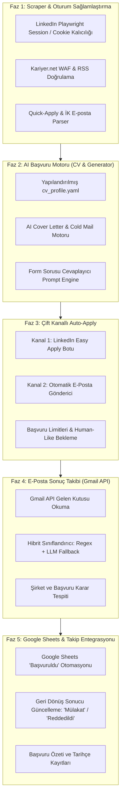

# 🎯 Tam Otonom Başvuru Pipeline'ı & Yenilenen Yol Haritası Planı

Bu belge, Job Radar projesinin 6 aylık aradan sonra yeniden canlandırılması, `README.md` yol haritasının temizlenip güncellenmesi ve adım adım **Tam Otonom End-to-End Başvuru ve Sonuç Takip Motoruna** dönüştürülmesi için mimari planı tanımlar.

---

## 📌 Kullanıcı Kararları & Temel Prensipler

1. **Token & Dosya Gezinimi Verimliliği:** Kod tabanında gezinirken `graphify-out/graph.json` ve AST haritası baz alınacak; körlemesine çoklu dosya aramaları engellenecek.
2. **Roadmap Temizliği:**
   - ❌ `Skill Gap Analizi` kaldırıldı.
   - ❌ `Duplicate Tespit` kaldırıldı (çift ilan olsa dahi ikisine de başvurmak avantajlıdır).
   - ❌ `Interview Prep` kaldırıldı.
   - ❌ `Discord Bot / Telegram Bot` kaldırıldı (Sistem tamamen headless/arka planda çalışacak, tüm durumlar doğrudan Google Sheets ve loglara yazılacak).
3. **Başvuru Kanalları (End-to-End):**
   - **Kanal 1:** LinkedIn Easy Apply (Playwright form otomasyonu).
   - **Kanal 2:** Otomatik E-posta Başvurusu (İlan metninden İK e-postasını regex/NLP ile ayıklayıp, kişiselleştirilmiş Cover Letter ve PDF CV ekleyerek gönderme).
4. **AI & Bilgi Motoru:**
   - Yerel CV profili (`cv_profile.yaml` / JSON) + Gemini / Claude / OpenAI API istemcisi üzerinden ilana özel cover letter üretimi ve form sorularını yanıtlama.
5. **Geri Dönüş & Sonuç Takibi (Feedback Loop):**
   - **Gmail API (OAuth 2.0)** ile gelen başvuru yanıtlarının (Red, Mülakat, Görüşmede, İşe Alındı) otomatik taranması.
   - **Hibrit Sınıflandırma:** Önce hızlı ve maliyetsiz Regex kuralları (`unfortunately`, `interview invitation`, `reddedildi` vb.) ile tarama; kararsız/karmaşık e-postaları LLM'e analiz ettirerek şirket ve durum tespiti yapma.
   - Tespit edilen durumların doğrudan Google Sheets'teki ilgili ilanın `Durum` sütununa yazılması.

---

## 🗺️ Yenilenen Aşama ve Yol Haritası

---

## 🛠️ Detaylı Uygulama Planı (Fazlar ve Görevler)

### Faz 1: Scraper & Oturum Sağlamlaştırma (Veri Güvencesi)
* 6 ay sonrasında LinkedIn scraping ve oturum durumları test edilir.
* Sürekli oturum açma ihtiyacını ortadan kaldırmak için Playwright `storage_state` (cookie saklama) mekanizması kurulur.
* İlan açıklamalarından `apply_email` (örn: `careers@company.com`, `ik@firma.com`) ve `easy_apply_eligible` bayrağını çıkaran parser entegre edilir.

### Faz 2: AI Başvuru Motoru (Profile & Cover Letter Generator)
* Kullanıcının deneyimlerini, projelerini, yeteneklerini ve iletişim bilgilerini içeren `config/cv_profile.yaml` şablonu oluşturulur.
* `src/core/application_generator.py`: İlanın başlığı, gereksinimleri ve şirket adına göre kişiselleştirilmiş, profesyonel Türkçe/İngilizce ön yazı (Cover Letter) ve Cold E-posta gövdesi üreten servis yazılır.
* Easy Apply formlarındaki yaygın soruları ("Kaç yıl C# deneyiminiz var?", "Ankara'da ikamet ediyor musunuz?") CV profiline göre yanıtlayan mantık eklenir.

### Faz 3: Tam Otonom Başvuru Yürütücüsü (Auto-Apply Engine)
* **LinkedIn Easy Apply (`src/clients/easy_apply_client.py`):**
  * Playwright kullanarak ilanın "Kolay Başvuru" butonuna tıklar.
  * Form adımlarını gezer, telefon/iletişim bilgilerini doldurur, yerel PDF CV'yi yükler, şirket sorularını AI/profil yardımıyla doldurur ve başvuruyu tamamlar.
  * Captcha veya aşırı karmaşık çok adımlı testlerde güvenli şekilde durur/atlanır.
* **E-Posta Gönderici (`src/clients/email_client.py`):**
  * İlanda direkt İK e-postası verilmişse, dinamik ön yazı ve ekte CV ile profesyonel başvuru e-postası yollar.
* **Savunmacı Güvenlik & Rate Limiting:**
  * Günlük başvuru sınırı (örneğin günde en fazla 15-20 başvuru).
  * Human-like rastgele gecikmeler (10 - 45 saniye).

### Faz 4: Otomatik E-posta Okuma ve Sonuç Takibi (Gmail API)
* **Gmail API İstemcisi (`src/clients/gmail_tracker.py`):**
  * Kullanıcının Gmail gelen kutusuna bağlanarak son başvuru maillerini (Greenhouse, Lever, LinkedIn, Workday, doğrudan şirket İK'ları) tarar.
* **Hibrit Sınıflandırıcı (`src/core/email_classifier.py`):**
  * 1. Adım: Hızlı regex kural motoru ile bariz red (`regret to inform`, `başka adaylarla devam`, vb.) veya davet (`interview`, `görüşme daveti`, `assessment`) maillerini sıfır token maliyetiyle tespit eder.
  * 2. Adım: Karmaşık veya belirsiz e-postaları LLM'e (Gemini vb.) göndererek ilgili şirket adı ve kesin başvuru durumunu (`Mülakat`, `Reddedildi`, `Görüşmede`) çıkarır.

### Faz 5: Tablo Senkronizasyonu ve Raporlama
* Başarıyla başvurulan ilanların Google Sheets'teki `Durum` sütunu otomatik olarak `Başvuruldu` şeklinde güncellenir.
* Gelen e-posta sonuçlarına göre tablodaki ilgili satırın durumu `Reddedildi` veya `Mülakat` olarak güncellenir (renk ve Smart Chip formatları otomatik uygulanır).
* `main.py`'ye yeni menü seçenekleri eklenir:
  * `8. Otonom Başvuru (Tara + Skorla + Başvur)`
  * `9. E-posta Yanıtlarını Kontrol Et (Gmail Sync)`

---

## 📂 Dosya Değişiklik Haritası

### 1. Dokümantasyon & Yol Haritası
* `README.md`:
  - Eski `v0.7 - v1.0` yol haritası arındırılır.
  - "Tam Otonom Başvuru & Gmail Takip Pipeline'ı" yeni mimari hedef olarak belgelenir.

### 2. Konfigürasyon & Veri Modelleri
* `src/utils/config.py`: Gmail OAuth kapsamları, LinkedIn storage ayarları ve LLM sağlayıcı değişkenleri.
* `cv_profile.yaml`: Kullanıcının CV ve profil verilerini barındıran yerel dosya.
* `src/core/models.py`: İlan modeline `apply_email`, `is_easy_apply` alanları eklenir.

### 3. Çekirdek Servisler
* `src/core/application_generator.py`: LLM tabanlı ön yazı ve form yanıtlama motoru.
* `src/clients/easy_apply_client.py`: LinkedIn Easy Apply Playwright modülü.
* `src/clients/email_client.py`: Başvuru e-postası göndericisi.
* `src/clients/gmail_tracker.py`: Gmail API ile gelen kutusu okuma istemcisi.
* `src/core/email_classifier.py`: Hibrit (Regex + LLM) e-posta yanıt sınıflandırıcısı.

---

## 🔍 Doğrulama Planı

1. **Roadmap & Git Doğrulama:** `README.md` dosyasının güncellenmesi ve Git commit/push yapılması.
2. **Scraper Testi:** LinkedIn ve RSS kaynaklarının güncel internet ortamında hatasız veri çektiğinin test edilmesi.
3. **AI Üretim Testi:** Örnek bir GameDev ilanı için `application_generator.py` ile ön yazı üretiminin doğrulanması.
4. **Gmail Bağlantı Testi:** Gmail API ile gelen kutusundan örnek başvuru e-postalarının okunabilirlik testi.
5. **Dry-Run Başvuru Testi:** Gerçek başvuru butonuna basmadan önceki form adımlarının simülasyonu.
